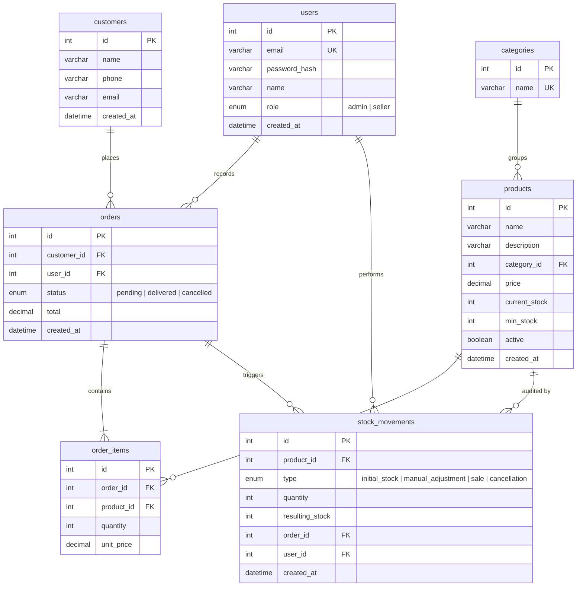
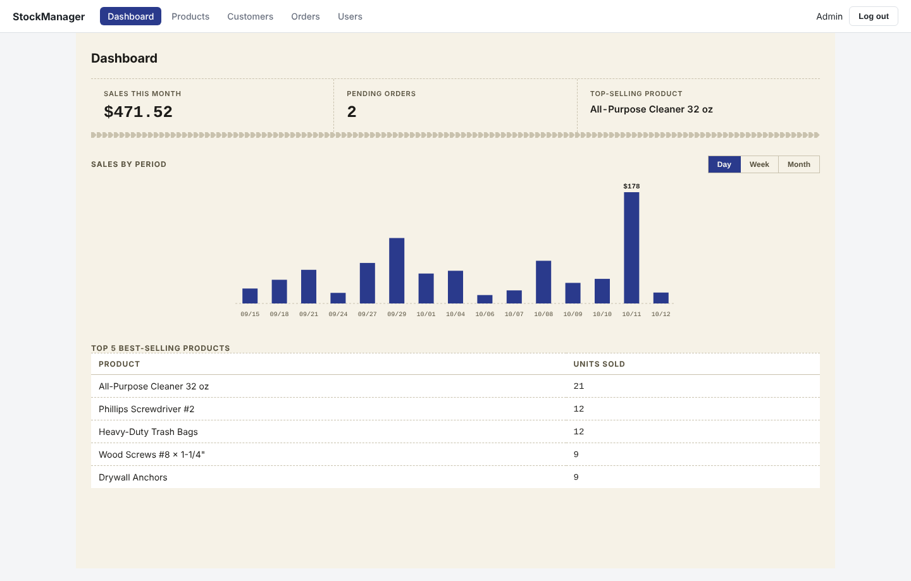
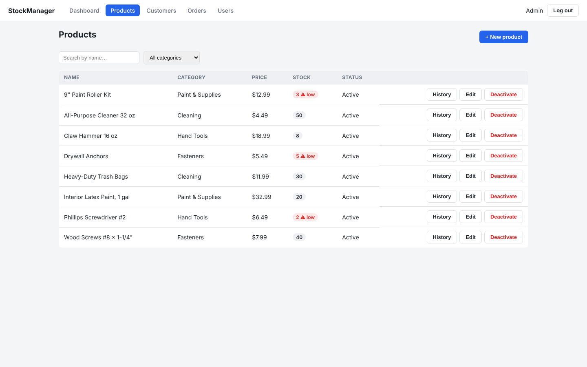
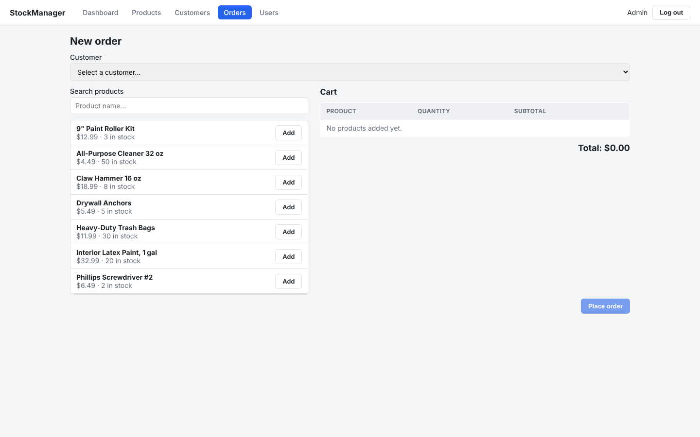
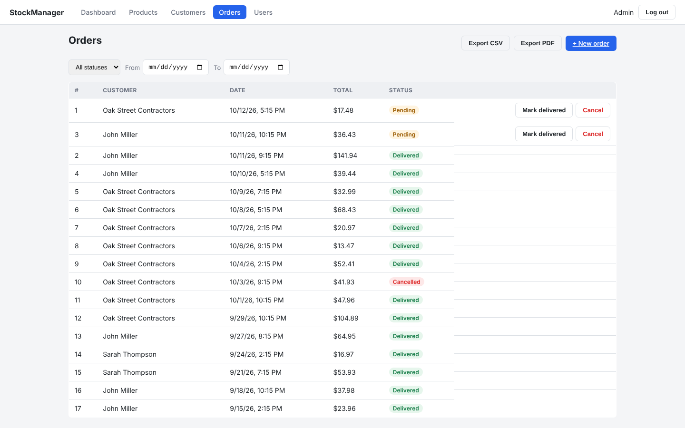
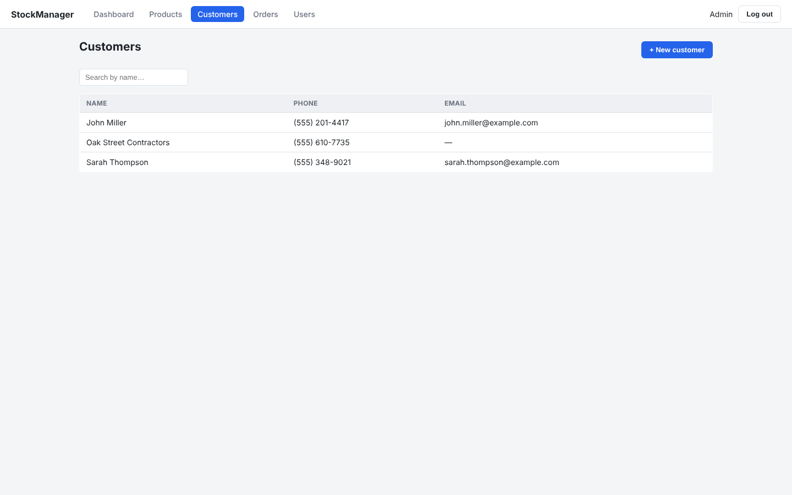
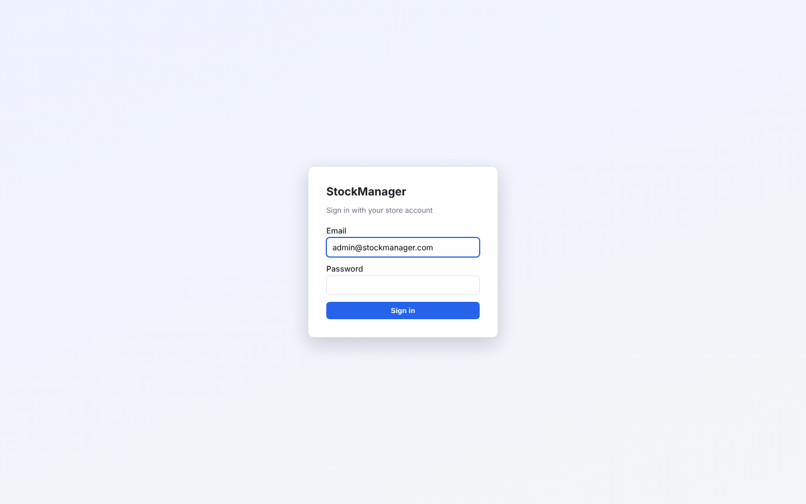

# StockManager

**Real-time inventory and order management for small businesses — a full-stack React, Express and MySQL app built end to end, from the relational schema up.**

StockManager is an internal back-office panel for a small store. Staff create orders from a live product search, stock is decremented atomically the moment an order is placed (and restored if it is cancelled), every stock change is written to an audit trail, and admins get a sales dashboard, CSV/PDF exports and user management.


---

## Table of contents

- [Features](#features)
- [Tech stack](#tech-stack)
- [Architecture](#architecture)
- [Data model](#data-model)
- [API reference](#api-reference)
- [Getting started](#getting-started)
- [Demo credentials](#demo-credentials)
- [Project structure](#project-structure)
- [Screenshots](#screenshots)
- [Roadmap](#roadmap)

## Features

- **JWT authentication** with two roles — `admin` and `seller` — enforced in the API (`403` on forbidden routes) and reflected in the UI (controls a seller can't use are hidden, not just disabled).
- **Product catalog** — create, edit and soft-delete products with category, price, current stock and a configurable minimum-stock threshold. Products at or below their threshold are flagged as **low stock**.
- **Customers** — searchable list and quick create.
- **Order builder** — pick a customer, search products, add them to a cart, adjust quantities and watch the total update live. The order can never exceed available stock.
- **Transactional stock control** — placing an order locks the affected product rows (`SELECT … FOR UPDATE`), validates stock, decrements it and writes the order inside a single transaction. Cancelling a pending order puts the stock back.
- **Frozen line-item prices** — `order_items.unit_price` is captured at the time of sale, so later price changes never rewrite order history.
- **Stock movement audit trail** — every initial stock entry, manual adjustment, sale and cancellation is recorded with the resulting stock level, the user who made it and the related order. Viewable per product from the Products page (admin).
- **Order list** with status (`pending`, `delivered`, `cancelled`) and status/date-range filters.
- **CSV and PDF export** of the order list, honoring the active filters (CSV is UTF-8 with BOM so it opens cleanly in Excel; PDF is generated server-side with `pdfkit`).
- **Admin dashboard** — sales this month, pending orders, top-selling products, and a sales-by-period bar chart (day / week / month) hand-drawn in inline SVG with no charting library.
- **User management** — admins can create users and assign roles.

## Tech stack

| Layer     | Technology |
|-----------|------------|
| Frontend  | React 19, Vite, React Router 7, Axios, Context API, plain CSS (custom properties — no UI library) |
| Backend   | Node.js 22, Express 4, `mysql2` (hand-written parameterized SQL, no ORM), `jsonwebtoken`, `bcryptjs`, `pdfkit` |
| Database  | MySQL 8 (InnoDB, foreign keys, `CHECK` constraints, indexes) |
| Tooling   | Docker Compose (MySQL + API + SPA with hot reload), nodemon, oxlint |

React is used **without a meta-framework** on purpose: routing, state and data fetching are wired by hand to show the fundamentals. SQL is written by hand for the same reason — the goal is to show real relational modeling, not an ORM's defaults.

## Architecture

```
┌──────────────────────┐   HTTP + JWT     ┌──────────────────────┐    mysql2    ┌──────────────┐
│  React SPA (Vite)    │ ───────────────▶ │  Express REST API    │ ───────────▶ │   MySQL 8    │
│  React Router, Axios │ ◀─────────────── │  auth · roles · tx   │ ◀─────────── │   InnoDB     │
└──────────────────────┘      JSON        └──────────────────────┘              └──────────────┘
      :5173                                        :4000                              :3306
```

- **`frontend/`** — single-page app. An Axios client attaches the bearer token and redirects to `/login` on `401`. Route guards (`ProtectedRoute`, `RequireAdmin`) mirror the API's role checks.
- **`backend/`** — layered Express app: `routes/` → `controllers/` → a shared connection pool. `middleware/auth.js` provides `requireAuth` and `requireRole(...)`; `middleware/errorHandler.js` centralizes error responses. Multi-step writes (orders, stock adjustments, cancellations) run inside explicit transactions.

## Data model

The full, commented schema lives in [`backend/src/db/schema.sql`](backend/src/db/schema.sql).



Key design decisions:

- `order_items` resolves the many-to-many relationship between `orders` and `products` and freezes `unit_price` at the time of sale.
- Products are **soft-deleted** (`active = false`) so historical order lines keep a valid foreign key.
- `stock_movements.quantity` is signed (`+` stock in, `-` stock out) and `resulting_stock` stores the level after the movement, so the history reads without recomputing running totals.
- `CHECK` constraints guard against negative prices, negative stock and non-positive quantities at the database level, in addition to API validation.

## API reference

All routes are prefixed with `/api`. Every route except `POST /auth/login` and `GET /health` requires an `Authorization: Bearer <token>` header.

| Method   | Endpoint                    | Role   | Description |
|----------|-----------------------------|--------|-------------|
| `POST`   | `/auth/login`               | public | Returns `{ token, user }` |
| `GET`    | `/health`                   | public | Health check |
| `GET`    | `/categories`               | any    | List categories |
| `GET`    | `/products`                 | any    | List products (`?search=`, `?category_id=`, `?active=true\|false`) |
| `GET`    | `/products/:id`             | any    | Get a product |
| `POST`   | `/products`                 | admin  | Create a product (records an `initial_stock` movement) |
| `PUT`    | `/products/:id`             | admin  | Update a product (stock changes record a `manual_adjustment`) |
| `DELETE` | `/products/:id`             | admin  | Soft-delete a product |
| `GET`    | `/products/:id/movements`   | admin  | Stock movement history for a product |
| `GET`    | `/customers`                | any    | List customers (`?search=`) |
| `POST`   | `/customers`                | any    | Create a customer |
| `GET`    | `/orders`                   | any    | List orders (`?status=`, `?from=YYYY-MM-DD`, `?to=YYYY-MM-DD`) |
| `GET`    | `/orders/:id`               | any    | Get an order with its line items |
| `POST`   | `/orders`                   | any    | Create an order: `{ customer_id, items: [{ product_id, quantity }] }` |
| `PATCH`  | `/orders/:id/status`        | any    | Set status of a pending order to `delivered` or `cancelled` (cancelling restores stock) |
| `GET`    | `/orders/export`            | admin  | Export orders (`?format=csv\|pdf`, same filters as the list) |
| `GET`    | `/dashboard/summary`        | admin  | Sales this month, pending orders, top 5 products |
| `GET`    | `/dashboard/sales`          | admin  | Sales totals by period (`?group_by=day\|week\|month`, `?from=`, `?to=`) |
| `GET`    | `/users`                    | admin  | List users |
| `POST`   | `/users`                    | admin  | Create a user (`role`: `admin` or `seller`) |

Errors are returned as `{ "error": "message" }` with an appropriate status code (`400`, `401`, `403`, `404`, `500`).

## Getting started

### Option A — Docker Compose (recommended)

Requires Docker with Compose v2.

```bash
git clone <your-fork-url> stockmanager
cd stockmanager
docker compose up -d
```

This starts three services:

| Service  | URL                       |
|----------|---------------------------|
| Frontend | http://localhost:5173     |
| API      | http://localhost:4000/api |
| MySQL    | `localhost:3306`          |

The backend and frontend containers mount the source code as volumes and run with hot reload (`nodemon --legacy-watch` / Vite with polling), so edits on your machine are picked up automatically. The schema and seed data are loaded automatically the first time the MySQL volume is created (via `docker-entrypoint-initdb.d`).

Open http://localhost:5173/login and sign in with one of the [demo accounts](#demo-credentials).

After changing dependencies, rebuild with `docker compose up -d --build`. To reset the database to the seed state, run `docker compose down -v` and start again.

### Option B — Manual setup

Requires Node.js 22+ and MySQL 8 (or MariaDB 10.6+).

**1. Database** — either start only the MySQL container:

```bash
docker compose up -d mysql
```

…or use your own MySQL server and load the schema and seed data:

```bash
mysql -u root -p --default-character-set=utf8mb4 < backend/src/db/schema.sql
mysql -u root -p --default-character-set=utf8mb4 stockmanager < backend/src/db/seed.sql
```

> If you reuse an existing `stockmanager-mysql` volume that was created without the init scripts, load them into the container instead:
>
> ```bash
> docker exec -i stockmanager-mysql mysql -uroot -proot --default-character-set=utf8mb4 < backend/src/db/schema.sql
> docker exec -i stockmanager-mysql mysql -uroot -proot --default-character-set=utf8mb4 stockmanager < backend/src/db/seed.sql
> ```

**2. Backend**

```bash
cd backend
cp .env.example .env    # adjust DB credentials if you're not using docker-compose
npm install
npm run dev             # http://localhost:4000
```

**3. Frontend**

```bash
cd frontend
cp .env.example .env    # VITE_API_URL defaults to http://localhost:4000/api
npm install
npm run dev             # http://localhost:5173
```

### Environment variables

| Variable          | Where    | Default                       |
|-------------------|----------|-------------------------------|
| `PORT`            | backend  | `4000`                        |
| `DB_HOST`         | backend  | `127.0.0.1`                   |
| `DB_PORT`         | backend  | `3306`                        |
| `DB_USER`         | backend  | `stockmanager`                |
| `DB_PASSWORD`     | backend  | `stockmanager`                |
| `DB_NAME`         | backend  | `stockmanager`                |
| `JWT_SECRET`      | backend  | `change-me-in-production`     |
| `JWT_EXPIRES_IN`  | backend  | `8h`                          |
| `CORS_ORIGIN`     | backend  | `http://localhost:5173`       |
| `VITE_API_URL`    | frontend | `http://localhost:4000/api`   |

## Demo credentials

The seed data models a small hardware & general store (hand tools, fasteners, paint and cleaning supplies, prices in USD) with a few customers and historical orders so the dashboard has something to show.

| Role   | Email                     | Password    | Can do |
|--------|---------------------------|-------------|--------|
| Admin  | `admin@stockmanager.com`  | `admin123`  | Everything: catalog & pricing, stock history, dashboard, exports, user management |
| Seller | `seller@stockmanager.com` | `seller123` | Create and update orders, manage customers, browse products (read-only) |

## Project structure

```
.
├── backend/
│   ├── src/
│   │   ├── config/db.js              # mysql2 connection pool
│   │   ├── controllers/              # request handlers + SQL
│   │   │   ├── auth.controller.js
│   │   │   ├── categories.controller.js
│   │   │   ├── customers.controller.js
│   │   │   ├── dashboard.controller.js
│   │   │   ├── orders.controller.js
│   │   │   ├── products.controller.js
│   │   │   ├── stockMovements.controller.js
│   │   │   └── users.controller.js
│   │   ├── db/
│   │   │   ├── schema.sql            # commented schema + ERD summary
│   │   │   └── seed.sql              # demo data
│   │   ├── middleware/               # requireAuth / requireRole, error handling
│   │   ├── routes/                   # one router per resource
│   │   └── server.js                 # app entry point
│   ├── .env.example
│   └── Dockerfile
├── frontend/
│   ├── src/
│   │   ├── api/client.js             # Axios instance with auth interceptors
│   │   ├── components/               # Layout, Modal, SalesChart, StatusBadge, StockBadge, route guards
│   │   ├── context/AuthContext.jsx   # session state
│   │   ├── pages/                    # Login, Dashboard, Products, Customers, Orders, NewOrder, Users
│   │   ├── styles/index.css          # design tokens + component styles
│   │   ├── App.jsx                   # routes
│   │   └── main.jsx
│   ├── .env.example
│   └── Dockerfile
├── docker-compose.yml
├── DESIGN.md                         # dashboard visual design system
└── PRODUCT.md                        # product brief, users and principles
```

## Screenshots

| Dashboard | Products |
|-----------|----------|
|  |  |

| New order | Orders |
|-----------|--------|
|  |  |

| Customers | Login |
|-----------|-------|
|  |  |

## Roadmap

- [ ] Deploy (frontend on Vercel/Netlify, API + MySQL on Railway or Render)
- [ ] Automated API tests for order creation and cancellation flows
- [ ] Keyboard shortcuts for the order builder
